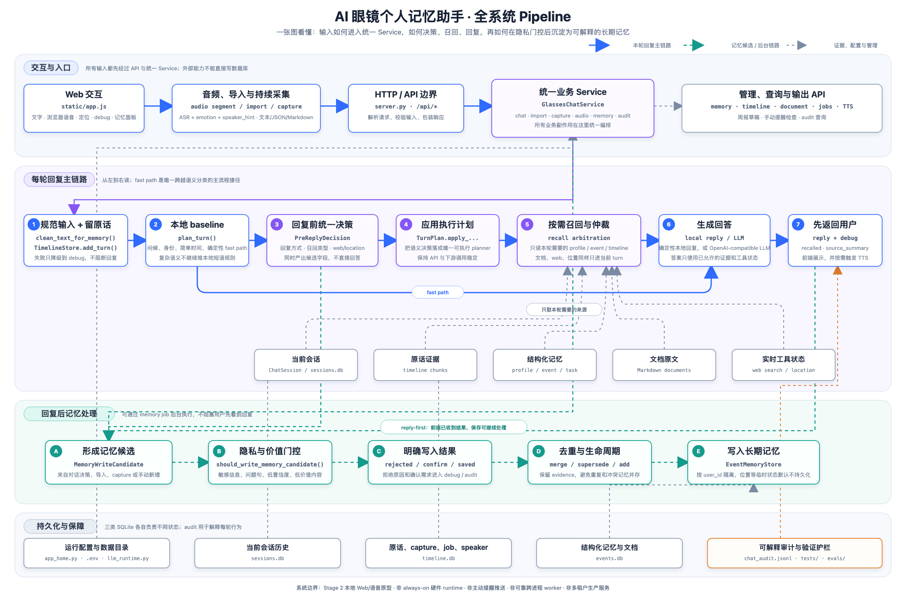

# 开发者上手入口

本目录只保留三份当前态文档，服务对象是第一次接手项目的开发者。文档只说明现在系统怎么启动、怎么改、怎么验证；不记录历史开发过程、迁移流水账、调研过程或复盘材料。

## 先看总览图



阅读顺序固定为：蓝色实线看本轮回复，绿色虚线看回复后的长期记忆处理，灰色虚线看证据、配置与管理入口，橙色虚线看 audit。图中中文是职责，下一行等宽文字是对应的代码入口；不需要先理解所有 helper 文件。

## 先读顺序

1. `README.md`：项目定位、快速运行、主要 API。
2. `AGENTS.md`：Codex/开发协作规则、验证命令、修改边界。
3. `CONTRIBUTING.md`：私人多人协作流程、分支、验证和提交前检查。
4. `PLANS.md`：当前优先级和下一步。
5. `docs/context/README.md`：本文件，开发者上手索引。
6. `docs/context/code-map.md`：按任务找代码入口。
7. `ai_glasses_memory_assistant/README.md`：包内所有 Python 文件职责速查，适合按文件名反查。
8. `docs/context/system-flow-current.md`：在总览图基础上展开当前系统架构、真实调用链和边界。

## 本地启动

下面命令里的 `/path/to/ai_glasses_memory_assistant` 请替换成你本机 clone 的仓库根目录。

推荐先设置本项目自己的 home：

```bash
export AI_GLASSES_HOME="$HOME/.ai-glasses-memory-assistant"
```

默认数据位置：

```text
$AI_GLASSES_HOME/data/events.db
$AI_GLASSES_HOME/data/timeline.db
$AI_GLASSES_HOME/data/sessions.db
$AI_GLASSES_HOME/data/chat_audit.jsonl
```

默认标准库 server：

```bash
cd /path/to/ai_glasses_memory_assistant
conda run -n hermes python -m ai_glasses_memory_assistant.server
```

默认访问：

```text
http://127.0.0.1:8765
```

本机浏览器使用这个 loopback 地址即可在 HTTP 下访问麦克风。若启动提示 `port is already used`，先用 `lsof -nP -iTCP:8765 -sTCP:LISTEN` 停止旧 HTTP/HTTPS server，或显式指定其他 `--port`；同一端口不要同时运行两个协议实例。

局域网设备测试语音或定位时使用 HTTPS：

局域网 IP 的 HTTP 页面不是浏览器安全上下文，只能展示普通页面，不能使用“开启全天待机”、声纹录入或定位。启动 HTTPS 后使用日志输出的 `https://<Mac 局域网 IP>:8765`。

```bash
cd /path/to/ai_glasses_memory_assistant
conda run -n hermes python -m ai_glasses_memory_assistant.server --certfile certs/cert.pem --keyfile certs/key.pem
```

## LLM 配置

推荐把配置写到：

```text
$AI_GLASSES_HOME/.env
```

可以从示例文件开始：

```bash
mkdir -p "$AI_GLASSES_HOME"
cp .env.example "$AI_GLASSES_HOME/.env"
```

默认使用 DeepSeek/OpenAI-compatible API：

```bash
AI_GLASSES_LLM_PROVIDER=deepseek
AI_GLASSES_LLM_MODEL=deepseek-v4-flash
AI_GLASSES_LLM_BASE_URL=https://api.deepseek.com
AI_GLASSES_LLM_API_KEY=<your-api-key>
AI_GLASSES_LLM_API_MODE=chat_completions
AI_GLASSES_LLM_TRANSPORT=openai_sdk
```

桌面默认 transport 是 `openai_sdk`；Android 内嵌 runtime 使用 `stdlib_http`，业务层仍复用同一个 `LLMClient` 接口。

如果 `AI_GLASSES_LLM_PROVIDER=deepseek` 且未设置 `AI_GLASSES_LLM_API_KEY`，运行时会尝试读取 `DEEPSEEK_API_KEY`。缺少 model、base URL 或 API key 时应直接报错。

主 LLM runtime 不再保留本地模型默认值或 legacy fallback。

音频模型变量：

```text
AI_GLASSES_ASR_MODEL_DIR
AI_GLASSES_STREAMING_ASR_MODEL_DIR
AI_GLASSES_SPEAKER_MODEL_DIR
AI_GLASSES_EMOTION_MODEL_DIR
AI_GLASSES_KWS_MODEL_DIR
AI_GLASSES_KWS_KEYWORDS_FILE
AI_GLASSES_WAKE_ACK_TEXT
```

模型目录保持在仓库外。未配置 streaming ASR 或 KWS 时，ambient 逐段转写仍可运行，但 capability 和页面会明确显示“语音唤醒问答不可用”；网页不提供手动唤醒降级入口。

多人重叠语音当前先走离线候选筛选：`scripts/p1_eval_ali_overlap_baseline.py` 用 AliMeeting 的远场混音和逐说话人近讲轨测量前端可改善上限；`scripts/p1_mossformer_overlap_pilot.py` 用固定双人高重叠片段比较 raw、双流分离和 near oracle 的置换不变 CER。两者都要求复用已有 Eval_Ali run 锁定的 ASR checkpoint，输出只属于公开数据算法证据。near 轨、分离模型输出和 Android 实际输入必须分开标记；只有真机 `actual_input_route` 与录音条件可证明设备收音效果。

公开资源的当前分工是：AliMeeting 用作中文真实会议主基准，AISHELL-4 用作更多说话人的跨数据集复核，LibriCSS 用作连续重叠分离和跨语言检查。候选只有同时报告重叠收益、非重叠退化、实时率、模型体积和连续分块限制后，才进入 Android 设计；离线模型不加入产品依赖。

全天讨论归档使用 `AI_GLASSES_DISCUSSION_*` 集中配置。默认以静音 180 秒、连续 900 秒、40 个 final 片段或跨日为切片边界，回顾最多等待后台归档 15 秒；脱敏后的 ambient 原文保留 30 天，话题和每日摘要保留到用户手动删除。最近 6 段仍只用于“刚才”即时上下文，不是全天输入上限。

## 依赖边界

当前 Python 包配置在 `pyproject.toml`。默认依赖只有 `openai`；可选能力按 extra 分组：

| extra | 依赖 | 用途 |
| --- | --- | --- |
| `tts` | `edge-tts` | 可选语音播报 |
| `voice` | `funasr`、`torch`、`numpy`、`soundfile` | 可选本地 ASR、声学情绪、声纹模型 |
| `voice-stream` | `silero-vad`、`sherpa-onnx` | 可选流式 VAD/KWS；缺少 Silero 时只保留收音诊断，不开放持续音频工作流 |
| `dev` | `pytest` | 测试 |

正式发布或部署前必须重新检查依赖 pin、package data 和安装流程。

## 常用验证

文档或小改动：

```bash
cd /path/to/ai_glasses_memory_assistant
git diff --check
```

Python 改动至少跑：

```bash
cd /path/to/ai_glasses_memory_assistant
conda run -n hermes python -m py_compile ai_glasses_memory_assistant/*.py ai_glasses_memory_assistant/evals/*.py server.py
conda run -n hermes python -m pytest tests -q
```

默认单元测试包括 `tests/test_audio_engine.py` 的 fake backend 音频契约，不加载真实模型。

需要 live eval 时：

```bash
cd /path/to/ai_glasses_memory_assistant
conda run -n hermes python -m ai_glasses_memory_assistant.evals.runner --mode live --repeat 3 --strict
```

通用背景音频记忆闭环评测 V2 不需要 Mac 播放或 Android 手机。它把 Eval_Ali_far 第 1 通道 WAV 以 256 ms PCM16 小帧送进真实 `AudioSession`；数据集只是当前远场环境音来源，不把产品逻辑写死为“会议”。`smoke` 运行 8 个人工金标窗口，验证关键事实转写、每日回顾/讨论归档、真实 `chat()` 后续问答、证据 ID 溯源和“环境音不可写入长期个人记忆”门禁；`full` 回放 8 段完整源音频，额外输出全量 CER/VAD/匿名说话人诊断、归档和吞吐健康报告。它是共享软件链路成绩，不是麦克风声学成绩。归档和诊断 judge 只允许明确的本地 Qwen 配置：

```bash
AI_GLASSES_LLM_PROVIDER=llama_cpp \
AI_GLASSES_LLM_MODEL=qwen3.8-27b-32k \
AI_GLASSES_LLM_BASE_URL=http://10.252.17.5:11438/v1 \
AI_GLASSES_LLM_API_KEY=ollama \
conda run -n hermes python scripts/run_eval_ali_offline.py \
  --preset smoke --run-id offline-smoke-001
```

默认尽快处理；加 `--realtime` 才按 1×持续喂入。结束后先看 `reports/eval_ali/<run-id>/summary.md`，再看 `scores.json`、`diagnosis.json` 和各 case 的 `health.json` / `closure.json`。金标位于 `data/benchmarks/eval_ali/ambient_memory_v2_gold.json`，包含 8 个窗口和 16 个问题，但它只作为评分输入，绝不注入 ASR、归档或聊天。三次 `--preset full` 均完整且隐私门禁为零后，使用 `scripts/lock_eval_ali_offline_baseline.py` 锁定 V2 中位数基线；快速和实时模式不能互相比较。

运行时终端会显示当前环境源和归档/闭环状态；即使模型、数据或配置在启动阶段失败，也会在同一 `reports/eval_ali/<run-id>/run-error.json` 留下错误原因。`ready_late` 或 `incomplete` 不计入每日回顾和问答成功。若 `conda run` 只显示 `See above for error`，改用 `conda run --no-capture-output -n hermes ...`，可直接看到 Python 的完整报错。

V2 的环境音模型 profile 必须显式选择：`legacy` 保留 Python Silero + FunASR SenseVoiceSmall 基线（A）；`sherpa_2024` 用 Android 原 SenseVoice ONNX 与 Sherpa Silero（B）；`sherpa_ten_2024` 是 Ten VAD-only（C）；`sherpa_silero_2025` 是 ASR-only（D）；`candidate` 用 Ten VAD 与 SenseVoice 2025 INT8（E）。Sherpa profile 分别要求设置模型目录/文件环境变量，runner 会把 profile、模型 SHA-256、运行时实际 VAD 参数和 sherpa 版本写进 manifest，因此不能用 `--resume` 或基线比较混合模型结果。health 同时报告总 CER、删除/替换/插入分量、重叠负担和加权 DER。候选 profile 不会静默改变桌面或 Android 默认行为。SenseVoice 2025 无标点输出，首轮不额外加入标点模型，归档读取原始 final 文本。

```bash
# B：Android 原 ONNX 2024 对照；C/E 只需替换 VAD 或同时使用 candidate 路径。
AI_GLASSES_EVAL_SENSEVOICE_2024_MODEL_DIR=/path/to/sensevoice-2024 \
AI_GLASSES_EVAL_SILERO_VAD_MODEL=/path/to/silero_vad.onnx \
AI_GLASSES_LLM_PROVIDER=llama_cpp AI_GLASSES_LLM_MODEL=qwen3.8-27b-32k \
AI_GLASSES_LLM_BASE_URL=http://10.252.17.5:11438/v1 AI_GLASSES_LLM_API_KEY=ollama \
conda run -n hermes python scripts/run_eval_ali_offline.py --preset smoke --audio-profile sherpa_2024 --run-id eval-ali-b-2024
```

固定消融矩阵的 profile 是：A `legacy`；B `sherpa_2024`（需要 2024 model + Silero）；C `sherpa_ten_2024`（2024 model + Ten）；D `sherpa_silero_2025`（2025 model + Silero）；E `candidate`（2025 model + Ten）。环境变量分别是 `AI_GLASSES_EVAL_SENSEVOICE_2024_MODEL_DIR`、`AI_GLASSES_EVAL_SENSEVOICE_CANDIDATE_MODEL_DIR`、`AI_GLASSES_EVAL_SILERO_VAD_MODEL` 和 `AI_GLASSES_EVAL_TEN_VAD_MODEL`；每次仅切 `--audio-profile` 与对应 `--run-id`，金标、channel 0 和 scorer 不变。

Android 原生对照先用 `scripts/prepare_eval_ali_android_replay.py --out /safe/outside/reports` 生成 8 个 16 kHz 单声道 WAV，逐个在设置页的离线测试中回放并复制 JSONL。再以 `--android-events-jsonl <events.jsonl> --preset smoke --audio-profile candidate` 评分。这个模式只读最终事件且明确标为 `android_native_vad_asr_only`；它不是每日归档/问答，也不是手机、蓝牙或眼镜麦克风声学成绩。

## 当前边界

当前同时包含局域网 Web/语音原型、`android/` 下的 Android 8+ arm64 本地 demo，以及 `ios/AIGlassesMicProbe/AIGlassesMemoryAssistant` 的 iOS 16+ 开发 Target。iPhone 已复用网页界面、Keychain 身份、原生定位、TTS 和原生异步桥接，并通过 `WKHTTPCookieStore` 加载 Python localhost 地址。sherpa-onnx v1.13.4 与 onnxruntime 1.27.1（API 27）已锁定，五组件模型支持非主线程加载和 `idle/loading/ready/failed` 状态机。音频输入支持蓝牙 HFP 优先和显式授权的 iPhone 内置麦克风兜底。iOS 原生音频事件通过 `start_capture`/`set_device_state`/`ingest_audio_event`/`wait_audio_event`/`stop_capture` 接入共享 Python runtime。numpy 1.26.2 已实际交叉编译并通过依赖目录、App bundle 和 arm64 校验；iOS Python import smoke、真机安装、真实 HFP 路由、文字聊天和记忆/audit 闭环仍未完成，且设备枚举仍受 `CoreDeviceService` 阻塞，不能当作正式可用客户端。

代码是真相。文档冲突时先读代码，再修文档。

## 隔离的联机收尾验收

`scripts/run_live_memory_closeout.py`冻结封存基线与当前源码，在实际模型POST前通过本机权威账预占请求；只允许指定本地Qwen和stdlib_http传输，每变体最多5次、总上限640，不自动重试。`scripts/run_live_memory_experience.py web|android`驱动独立Chrome/Android WebView的真实文字表单，按实际播放事件计TTS；环境变量`AI_GLASSES_ACCEPTANCE_DEVICE_SERIAL`显式指定本轮ADB设备，`AI_GLASSES_ACCEPTANCE_ARMS`可只执行尚未启动的独立版本。已使用变体不可重跑，后台与请求账未结束时不能进入下一项。

Android仅debug构建支持`-PacceptanceVariant=before|after`，生成独立包名`.acceptance.before|after`；启动需要本次acceptance_token。只在这些包中初始化本地模型与合成数据，原应用和默认构建保持现状。凭证文件不入版本控制；ADB错误日志不得输出带凭证的启动参数。派生标签索引只安装于测试库，真实库仍需独立批准。

`scripts/report_live_memory_closeout.py --root <本次证据目录>`校验模型账、源码/APK与逐条答案哈希，创建新的报告目录，不覆盖旧报告、不调用模型。文字入口、固定音频及真实麦克风证据分别报告；缺测保持缺测。


## 仅质量的新版本验收

`scripts/run_memory_quality_revision.py`读取已授权且事前冻结的`protocol.json`和`conditions.json`；`freeze`保存当前源码，`authority`继承封存父账的请求和变体次数，`quality`只运行新版本24条件。新目录最多120请求，每变体最多5次，累计640请求/124已尝试变体；失败及未知尝试计数，旧账哈希改变会阻止下一次发送。已经尝试的变体不再生成，未结束请求或后台任务阻止推进。该入口不构建或运行Android/Web，不安装真实库索引。

```bash
conda run -n hermes python scripts/run_memory_quality_revision.py verify --run <已冻结证据目录>
conda run -n hermes python scripts/report_memory_quality_revision.py --run <已冻结证据目录>
```

报告入口核验新源码/工具、父账、配置、逐例回答和人工复核哈希，只输出新的报告目录，不调用模型。历史留出案例已经被查看，不能称盲测；候选进入前五、进入回答上下文和答案正确使用分别记录，不能用其中一项替代另外两项。开启新一轮生成前仍须具备相应用户授权和冻结协议，不通过另开目录重置额度。

本轮真实质量一次验收：候选6/12→7/12、最终正确正例5/12→7/12、时间5/8→6/8，仍未通过且有UTC换算退化。质量新增67请求、累计328/640。报告路径为`.planning/2026-10-13-recall-time-repair/reports/20261013-111653/`；该报告保持质量阶段封存状态。随后用户另授权独立Web页面回归，见该任务`web/`协议与补充报告；仅新版本7变体，不将历史结果当作配对速度验收。Android仍停止，真实库索引未安装。

最新统一报告入口（零模型调用，新输出目录）：`conda run --no-capture-output -n hermes python scripts/report_memory_repair_closeout.py --run .planning/2026-10-13-recall-time-repair`。它校验质量源码、父账合并、Web冻结文件、完整分母、回复与审计ID及答案哈希。Web六热取得回复/播放，冷启动绑定失败不补跑；总353请求/109已尝试变体，未来新验收须继承这个最终累计账，不能重新使用328或261作为总已用额度。旧版本自然陈述时间标签覆盖正文的失败仍保留；新write-integrity-fix节点已阻止查询标签替换正文，并让纯写入确认由实际状态持有。job保存状态仍不能代替候选语义质量审核。

可配置写入策略：通过`AI_GLASSES_MEMORY_WRITE_POLICY_JSON`提供版本1 JSON，例如`{"version":1,"by_type":{"fact":{"min_confidence":0.8,"normalize_candidate_time":false},"task":{"require_confidence":true}}}`。支持每类`enabled`、`min_confidence`、`require_confidence`、`normalize_candidate_time`，覆盖现有七类记忆；空配置兼容原默认，修改后重启service生效。键名、类型及范围错误会拒绝启动，最低阈值不可低于0.6；敏感保护、纠错正文和查询时间标签不替换正文不受覆盖。该配置只决定是否和如何消费候选，不替代语义提取，且不会增加模型请求。纯写入处理中只说“收到，正在保存。”，没有后续结果展示承诺；保存状态仍可供审计和管理入口查询。
